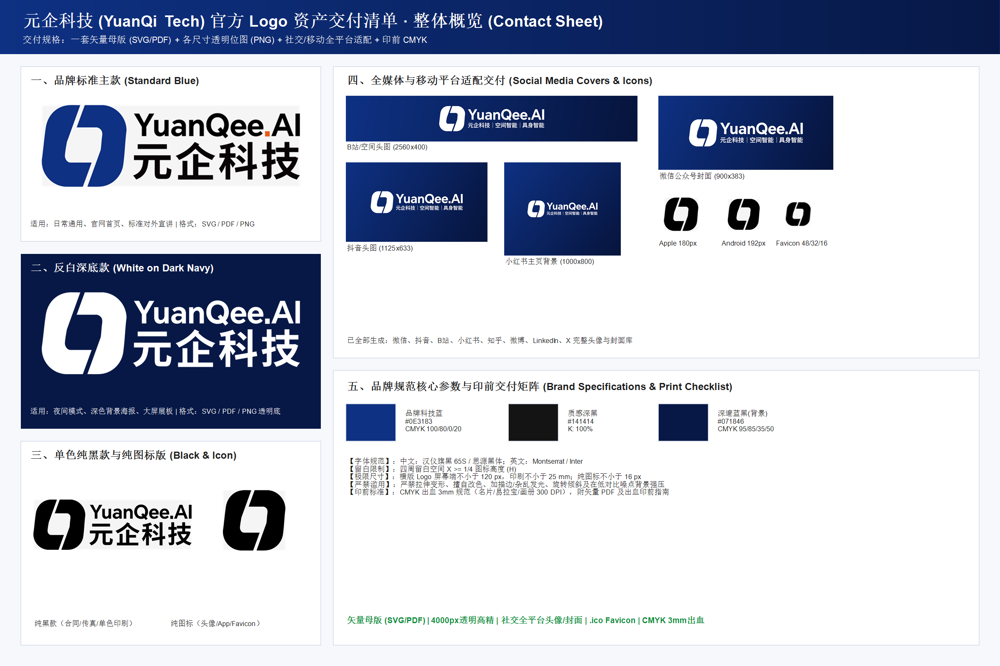

# 元企科技 (YuanQi Tech) 官方 Logo 资产库与智能体技能包

[](./LICENSE)
[](./SKILL.md)
[](#-�?agent-手动安装路径)

本仓库是遵循 **Agent Skills 开源规�?* 设计的标准技能包（Skill），封装了「元企科技 (YuanQi Tech)」官方全套矢量母版、透明底高精度位图、全媒体自适应头图、多分辨�?Favicon �?CMYK 印刷规范文件�?
已原生适配 **Anthropic Claude Code、OpenAI Codex、Tencent WorkBuddy、Google Antigravity、Cursor �?GitHub Copilot**�?
---

## 🌟 全局预览看板 (Contact Sheet)



---

## 🚀 极速安�?(Quickstart Installation)

### 1. 一键远程安装（推荐�?
通过 SSH �?HTTPS 协议一键自动注册到本地所�?Agent 技能目录：

#### macOS / Linux (Bash)
```bash
# HTTPS 协议一键安�?(默认自动注册�?~/.claude, ~/.workbuddy, ~/.gemini)
curl -fsSL https://raw.githubusercontent.com/hx785/yuanqi-logo-assets/main/install.sh | bash

# 使用 SSH 协议安装
curl -fsSL https://raw.githubusercontent.com/hx785/yuanqi-logo-assets/main/install.sh | bash -s -- --ssh

# 安装到指定开发项目根目录
curl -fsSL https://raw.githubusercontent.com/hx785/yuanqi-logo-assets/main/install.sh | bash -s -- --project /path/to/your-project
```

#### Windows (PowerShell)
```powershell
# HTTPS 协议一键安�?irm https://raw.githubusercontent.com/hx785/yuanqi-logo-assets/main/install.ps1 | iex

# 使用 SSH 协议安装
& ([scriptblock]::Create((irm https://raw.githubusercontent.com/hx785/yuanqi-logo-assets/main/install.ps1))) -Ssh

# 安装到指定项目工程根目录
& ([scriptblock]::Create((irm https://raw.githubusercontent.com/hx785/yuanqi-logo-assets/main/install.ps1))) -ProjectPath "D:\MyWebProject"
```

---

### 2. 通过 Git Clone 手动安装 (SSH / HTTPS)

根据您正在使用的 Agent，直接克隆到对应的技能目录即可：

| 目标 Agent | 协议 | Git Clone 安装命令 |
| :--- | :--- | :--- |
| **Claude Code** | **SSH** | `git clone git@github.com:hx785/yuanqi-logo-assets.git ~/.claude/skills/yuanqi-logo-assets` |
| | **HTTPS** | `git clone https://github.com/hx785/yuanqi-logo-assets.git ~/.claude/skills/yuanqi-logo-assets` |
| **Tencent WorkBuddy** | **SSH** | `git clone git@github.com:hx785/yuanqi-logo-assets.git ~/.workbuddy/skills/yuanqi-logo-assets` |
| | **HTTPS** | `git clone https://github.com/hx785/yuanqi-logo-assets.git ~/.workbuddy/skills/yuanqi-logo-assets` |
| **Google Antigravity** | **SSH** | `git clone git@github.com:hx785/yuanqi-logo-assets.git ~/.gemini/config/skills/yuanqi-logo-assets` |
| | **HTTPS** | `git clone https://github.com/hx785/yuanqi-logo-assets.git ~/.gemini/config/skills/yuanqi-logo-assets` |
| **Codex / 项目工作�?* | **SSH** | `git clone git@github.com:hx785/yuanqi-logo-assets.git .agents/skills/yuanqi-logo-assets` |
| | **HTTPS** | `git clone https://github.com/hx785/yuanqi-logo-assets.git .agents/skills/yuanqi-logo-assets` |

---

## 📐 开�?Skill 架构设计标准

本技能包严格遵循开源智能体规范�?**渐进式披露（Progressive Disclosure�?* 架构设计�?
```
yuanqi-logo-assets/
├── 📄 SKILL.md             # �?核心技能定义（规范 YAML Frontmatter + 决策�?+ 约束�?├── 📄 skill.yml            # Tencent WorkBuddy 原生技能元数据清单
├── 📄 CLAUDE.md            # Anthropic Claude Code 专用项目上下文与行为守则
├── 📄 AGENTS.md            # OpenAI Codex / Linux 基金会开放智能体通用标准
├── 📄 .cursorrules         # Cursor IDE 专用设计与引用规�?├── 📄 LICENSE              # 开源许可证 (MIT)
├── 📄 README.md            # 人类可读说明文档与全平台安装指南
├── 🖼�?contact_sheet.png     # 整体交付看板�?400×1600 高清�?├── 🔧 install.sh / .ps1    # 跨平台一键安装脚本（支持 SSH / HTTPS / 管道执行�?├── 📂 scripts/             # 可执行脚本目录（�?Agent 工具调用�?�?  └── get_logo.js         # 确定性资产检�?CLI
├── 📂 01_source/           # 矢量母版源文件（SVG / PDF�?├── 📂 02_png/              # 纯透明底位图导出（4000px, 2000px, 512px, 256px, App图标�?├── 📂 03_avatar/           # 全媒体自适应头像与封面（微信/视频�?抖音/B�?小红�?知乎/微博/X�?├── 📂 04_favicon/          # 浏览�?Favicon（多分辨�?PNG 及标�?Windows .ico�?└── 📂 05_print/            # 印前物料（CMYK PDF �?3mm 出血技术规范）
```

### 1. 启动轻量感知 (Discovery)
Agent 启动时仅解析 `SKILL.md` �?YAML 头，不占用过多上下文窗口�?```yaml
---
name: yuanqi-logo-assets
description: >-
  元企科技官方 Logo 资产库与场景调用指南。当用户需要获取元企科技 Logo 素材、在网页/应用/文档中嵌�?Logo、配置社交媒体头像与封面、准备印刷品（名�?合同/易拉宝），或需要依据设计规范自动挑选最合适尺寸与配色�?Logo 资产时激活此 Skill�?---
```

### 2. 按需动态激�?(Activation)
当用户的 Prompt 命中上述描述（如提到�?帮我加一个元企的 logo*”、�?暗黑模式下的 logo 是哪�?”），Agent 自动�?`SKILL.md` 正文加载�?Context，根据决策树精准定位文件�?
---

## 🎯 场景自动匹配决策�?
```
                         ┌── 诉求为「头�?/ 图标 / 水印 / 小尺�?/ Favicon�?
                         �?   ├── Favicon 图标 ────> 04_favicon/favicon.ico
                         �?   ├── 移动端图�?──────> 02_png/yuanqi_logo_icon_apple_180.png �?android_192.png
                         �?   ├── 社交通用头像 ────> 03_avatar/yuanqi_logo_avatar_master_1080.png
                         �?   └── 纯图标矢�?──────> 01_source/yuanqi_logo_icon_master.svg
                         �?                         └── �?── 确定【排版款式】与【配色体系】：
                                   �?                                   ├─ 1. 排版款式判断�?                                   �?   ├─「名片、正式、简洁�?──────────> 分隔线款 / 标准�?                                   �?   ├─「展会、宣传册、业务介绍�?────> 完整横版 / �?Slogan �?                                   �?   └─ 常规/默认展示 ──────────────────> 标准居中主款
                                   �?                                   └─ 2. 配色体系判断�?                                        ├─「深色底、黑底、夜景、暗黑模式�?─> 【反白款 (white)�?                                        ├─「文档、印刷、合同、黑白�?───────> 【单色纯黑款 (black)�?                                        └─ 默认/未指�?─────────────────────> 【品牌标准蓝 (color)�?```

---

## 🎨 品牌色彩与设计规�?
- **品牌科技�?(Primary Tech Blue)**：`#0E3183` | RGB `14, 49, 131` | CMYK `100, 80, 0, 20`
- **深邃蓝黑底色 (Dark Navy)**：`#071846` | RGB `7, 24, 70` | CMYK `95, 85, 35, 50`
- **质感深黑 (Neutral Black)**：`#141414` | RGB `20, 20, 20` | CMYK `0, 0, 0, 100`
- **纯白反白 (Pure White)**：`#FFFFFF` | RGB `255, 255, 255` | CMYK `0, 0, 0, 0`
- **安全留白**：四周预留空�?$X \ge \frac{1}{4} H$�?H$ 为图标高度）�?- **反白纯净�?*：反白版已严格去除底色块，保�?100% 透明通道�?
---

## 🛠�?CLI 辅助工具查询

Agent 或开发者可通过轻量�?CLI 工具直接获取绝对/相对路径�?```bash
# 查询暗黑模式下的 PNG 路径
node scripts/get_logo.js --scenario dark_mode --format png

# 输出 JSON 格式
node scripts/get_logo.js --scenario favicon --json
```

---

## 📄 开源许可证

本项目基�?[MIT License](./LICENSE) 开源�?
